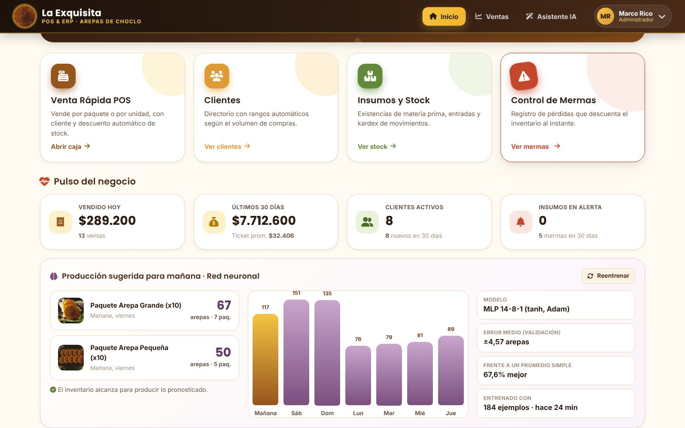
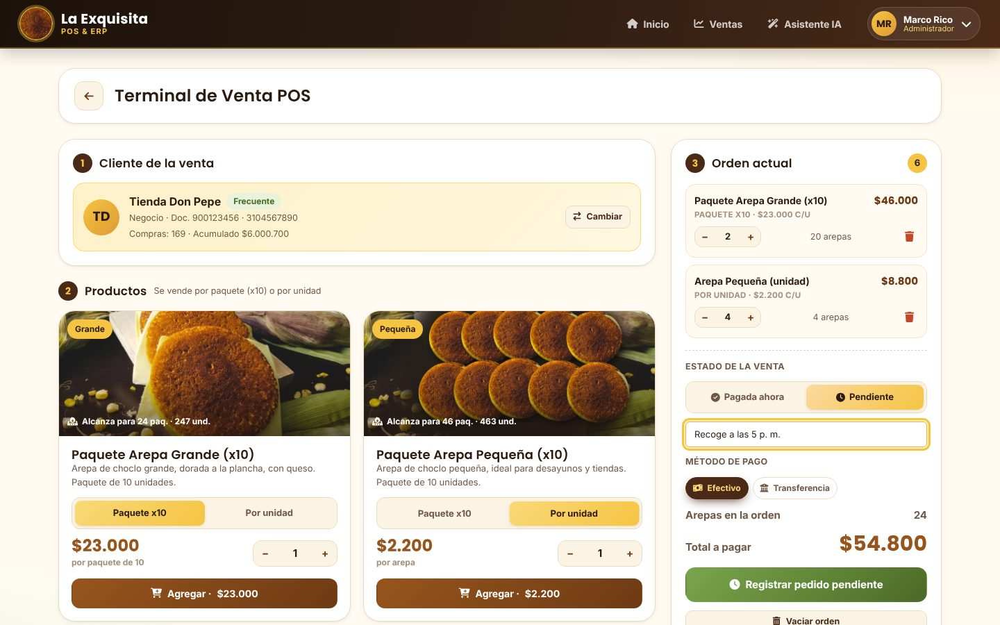

# La Exquisita · Sistema POS & ERP

Sistema transaccional por capas para **La Exquisita**, negocio de arepas de choclo: ventas de mostrador por **paquete (x10) o por unidad** con estados (pendiente, completada, devuelta) y devoluciones, clientes con rangos, inventario de insumos con kardex, control de mermas, una **red neuronal que pronostica la demanda** y un **asistente IA conectado en vivo a SQL Server**.

* **Proyecto:** Ingeniería de Software · UMB · Grupo 6
* **Stack:** HTML + CSS + JavaScript (módulos) · Node.js + Express · SQL Server
* **Documentación:** [`docs/`](docs/README.md) · [Arquitectura](docs/ARQUITECTURA.md) · [Servicio de IA](docs/IA.md) · [Persistencia](docs/PERSISTENCIA.md) · [Pruebas](docs/PRUEBAS.md) · [Guía de la demo](docs/GUIA_DEMO.md)



---

## Qué hace

| Módulo | Descripción |
|--------|-------------|
| **Inicio** | Indicadores en vivo (netos), **producción sugerida para mañana por la red neuronal**, gráfico de 7 días, paquetes que alcanzan con el inventario, alertas de stock y últimas ventas. |
| **Venta Rápida POS** | 1) Buscar y seleccionar el cliente, o registrar uno nuevo sin salir de la venta. 2) **Paquete Arepa Grande** y **Paquete Arepa Pequeña**, cada uno por paquete x10 o por unidad, con cantidad. 3) Estado **Pagada ahora** o **Pendiente** (pedido por cobrar), método de pago (efectivo o transferencia), confirmación y recibo imprimible. |
| **Clientes** | Directorio con búsqueda, rangos automáticos (Nuevo → Regular → Frecuente → VIP), detalle con historial de compras, edición y “vender a este cliente”. |
| **Insumos y Stock** | Existencias con barras de nivel, consumo de los últimos 7 días, días de cobertura, entradas de stock, creación/edición y kardex de movimientos. |
| **Control de Mermas** | Registro de pérdidas por insumo y motivo; **descuenta el stock** en la misma transacción. |
| **Ventas** | Historial con filtros por fecha y **estado**, totales netos y pendiente por cobrar. En el detalle: **completar** una venta pendiente o **registrar una devolución** (producto dañado, equivocado, cliente insatisfecho) con **reposición** del producto o **reembolso**. |
| **Asistente IA** | Responde con cifras reales de la base de datos: “¿cuántas arepas preparo mañana?”, “¿cuánto maíz hay?”, “¿cuántos paquetes grandes puedo hacer?”, “¿hay ventas pendientes?”, “devoluciones del mes”, “¿qué debo comprar?”… Funciona sin internet (motor local) y opcionalmente con OpenAI. |
| **Red neuronal** | Perceptrón multicapa programado desde cero (14-8-1) que aprende del historial de ventas y pronostica las arepas de los próximos 7 días por producto. Ver [`docs/IA.md`](docs/IA.md). |



---

## Estructura

```
ST_G6_LaExquisita/
├── backend/                     ← API REST (Node.js + Express)
│   ├── server.js                  arranque
│   ├── src/
│   │   ├── app.js                 middlewares + rutas + frontend estático
│   │   ├── config/                env.js (.env) · database.js (pool SQL Server)
│   │   ├── middlewares/           seguridad, sesión/roles, errores
│   │   ├── routes/                endpoints y permisos por rol
│   │   ├── controllers/           HTTP ↔ servicios
│   │   ├── services/              reglas de negocio y transacciones
│   │   │   └── ia/                    red neuronal, pronóstico y asistente
│   │   ├── repositories/          ÚNICO lugar con SQL (parametrizado)
│   │   ├── database/migrator.js   ejecuta schema.sql + seed.sql al arrancar
│   │   └── utils/                 validación, errores
│   ├── scripts/                   migrar · crear-usuario · generar-historial (demo IA)
│   ├── test/                      pruebas unitarias (npm test)
│   ├── pruebas/                   pruebas de integración y de extremo a extremo
│   └── .env.example               plantilla de configuración
├── frontend/                    ← Interfaz
│   ├── index.html                 estructura
│   ├── css/styles.css             estilos y colorimetría del logo
│   ├── js/
│   │   ├── main.js                punto de entrada
│   │   ├── core/                  config, http, estado, rutas
│   │   ├── services/              llamadas a la API
│   │   ├── views/                 una vista por pantalla
│   │   ├── components/            modales, toasts, selector de cliente
│   │   └── utils/                 escape anti-XSS, formatos COP
│   ├── assets/img/                logo, arepa grande, arepa pequeña
│   └── vendor/                    íconos y fuentes locales
├── database/
│   ├── schema.sql                 esquema idempotente (crea/actualiza sin borrar datos)
│   ├── seed.sql                   datos iniciales idempotentes
│   └── consultas.sql              reportes de solo lectura
└── docs/                        ← documentación
    ├── ARQUITECTURA.md · IA.md · PERSISTENCIA.md · PRUEBAS.md · GUIA_DEMO.md
    └── evidencias/                resultados de pruebas y capturas
```

---

## Puesta en marcha (Windows + SQL Server)

### Requisitos
* **Node.js** 18.19 o superior
* **SQL Server** (instancia `localhost\SQL2025`)
* Para autenticación de Windows: el driver **ODBC Driver 17 u 18 for SQL Server**

### 1. Instalar dependencias
```bash
cd backend
npm install
```

### 2. Configurar `backend/.env`
Copia la plantilla y ajústala:
```bash
copy .env.example .env
```
Lo mínimo (autenticación de Windows, como en SSMS):
```ini
PORT=3000
DB_AUTH=windows
DB_SERVER=localhost
DB_INSTANCE=SQL2025
DB_NAME=la_exquisita_db
JWT_SECRET=pon_aqui_una_cadena_aleatoria_de_32_o_mas_caracteres
```

### 3. Arrancar
```bash
npm start
```
El backend **crea o actualiza la base de datos automáticamente** (ejecuta `database/schema.sql` y `seed.sql`, que no borran datos). Luego abre:

 **http://localhost:3000**

### 4. Iniciar sesión
| Usuario | Rol | Contraseña temporal |
|---------|-----|---------------------|
| `marcori@gmail.com` | Administrador | `LaExquisita2026*` |
| `fawi@gmail.com` | Cajero | `LaExquisita2026*` |

En el primer ingreso el sistema **obliga a cambiar la contraseña**.

Para crear más usuarios:
```bash
npm run crear-usuario -- --nombre "Ana Pérez" --correo ana@laexquisita.com --rol cocina --password "Cocina2026"
```

## Si algo falla

Abre **http://localhost:3000/api/health**: dice si hay conexión, qué driver se usó y una **sugerencia en español** del problema. La interfaz también muestra un aviso rojo arriba y se reconecta sola cuando SQL Server vuelve.

| Mensaje | Solución |
|---------|----------|
| No se encontró el driver ODBC | Instala *ODBC Driver 18 for SQL Server* o define `DB_ODBC_DRIVER` en `.env` |
| No se encontró el servidor | Revisa que el servicio *SQL Server (SQL2025)* esté iniciado y que `DB_INSTANCE` sea correcto. Para instancias con nombre, inicia también *SQL Server Browser* |
| Login failed | Tu usuario de Windows no tiene acceso a la instancia, o `DB_USER`/`DB_PASSWORD` están mal |
| Falta msnodesqlv8 | Ejecuta `npm install` en `backend` (o usa `DB_AUTH=sql`) |

---

## Seguridad básica

Inicio de sesión con contraseñas **bcrypt**, sesión en **cookie httpOnly** (JWT), **roles** validados en el servidor (administrador, cajero, cocina), bloqueo tras 5 intentos fallidos, **consultas parametrizadas** (anti inyección SQL), **escape automático** y **Content-Security-Policy** (anti XSS), solo JSON en la API (anti CSRF), límites de peticiones, validación de todas las entradas y precios calculados en el servidor. Detalle en [`docs/ARQUITECTURA.md`](docs/ARQUITECTURA.md#4-seguridad-básica-implementada).

## Asistente IA

Por defecto usa el **motor local** (gratis, sin internet): entiende la pregunta en español y responde con las cantidades exactas de SQL Server. Para usar OpenAI agrega en `.env`:
```ini
OPENAI_API_KEY=tu_llave
OPENAI_MODEL=gpt-5.5
```
Si OpenAI falla, responde automáticamente el motor local. La IA es de **solo lectura**.

La red neuronal necesita al menos 21 días con ventas. Para la demostración se puede cargar un historial de práctica (queda marcado como `demo` y se borra con `--borrar`):
```bash
npm run historial-demo
```

## Pruebas
```bash
cd backend
npm test           # 19 pruebas unitarias
npm run test:api   # 15 pruebas de integración (con el backend corriendo; ver docs/PRUEBAS.md)
```
Resultados y casos de prueba en [`docs/PRUEBAS.md`](docs/PRUEBAS.md).

## Ajustes frecuentes
* **Precios:** `UPDATE dbo.productos SET precio = 24000, precio_unidad = 2500 WHERE tamano = 'grande';`
* **Recetas (gasto por arepa):** tabla `dbo.recetas`.
* **Logo:** reemplaza `frontend/assets/img/logo.png` (cuadrado, ideal 256×256)..
